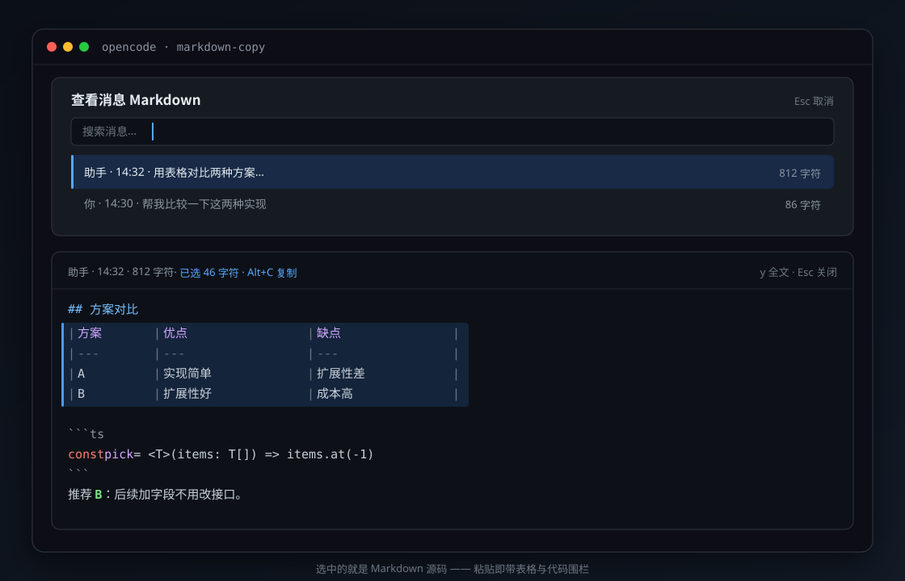

# markdown-copy

[](https://github.com/wuzhupc/markdown-copy/actions/workflows/ci.yml)
[](LICENSE)
[](https://opencode.ai)

**Open any OpenCode TUI session message as raw Markdown, then copy exactly the part you need.**

The built-in `/copy` only copies the last assistant reply, and it copies rendered text. `markdown-copy` opens the message's **original Markdown** in a read-only panel: drag-select two table rows, a code fence or half a list, press `Alt+C`, and the source lands in your clipboard — pipes, fences and `##` intact.



[简体中文](README.md) · [Changelog](CHANGELOG.md) · [Contributing](CONTRIBUTING.md)

---

## Why not the built-in `/copy`?

| | built-in `/copy` | markdown-copy |
| --- | --- | --- |
| Messages | last assistant reply | any user / assistant / compaction message |
| Granularity | whole message | any selection, or `y` for the whole message |
| Content | rendered text | raw Markdown source |
| Finding history | scroll and select manually | filterable picker, defaults to the last assistant reply |

## Features

- **Any historical message** — the picker lists user messages, assistant text and completed compaction summaries, with keyword filtering.
- **Selection = source** — the panel renders the message `text` verbatim, so whatever you select is valid Markdown.
- **Survives selection resets** — the selection is cached when the drag ends, so `Alt+C` still works if the host clears it on keypress.
- **Two clipboard channels** — Windows uses `Set-Clipboard` over UTF-8 stdin; macOS / Linux / SSH prefer OSC 52 and fall back to `pbcopy` / `wl-copy` / `xclip` / `xsel`.
- **No npm dependencies** — plain TypeScript / TSX / ESM, loaded directly by OpenCode.
- **Multiple entry points** — `Alt+M`, `/mdsrc` (aliases `/copymd`, `/md-copy`), or the `View message as Markdown` command palette entry.

## Requirements

- OpenCode **v2.4.1** or newer (the plugin API was verified against this version)
- TUI only (the `opencode` interactive interface)
- No third-party dependencies; `bun` is only needed for the pre-install bundle check and development

## Install

Plugin directory: `~/.config/opencode/plugins/markdown-copy` (on Windows: `%USERPROFILE%\.config\opencode\plugins\markdown-copy`).

### Windows

```powershell
git clone https://github.com/wuzhupc/markdown-copy.git
cd markdown-copy
pwsh -File .\deploy.ps1
```

### macOS / Linux

```bash
git clone https://github.com/wuzhupc/markdown-copy.git
cd markdown-copy
chmod +x ./install.sh
./install.sh
```

### Custom directory

```powershell
pwsh -File .\deploy.ps1 -Destination D:\tools\opencode-plugins\markdown-copy
```

```bash
./install.sh /path/to/plugins/markdown-copy
```

### Manual install

Copy `tui.ts`, `panel.tsx`, `messages.js`, `clipboard.js` and `package.json` into `~/.config/opencode/plugins/markdown-copy/`.

### Verify

```bash
opencode plugin list   # should list local .../plugins/markdown-copy
```

A running TUI watches the config directory and reloads the plugin automatically; restart it if the plugin does not appear.

## Usage

1. In a session press `Alt+M`, type `/mdsrc` (or `/copymd`, `/md-copy`), or use `Ctrl+P` → `View message as Markdown`.
2. Pick a message in the picker (type to filter; the last assistant reply is preselected).
3. In the source panel:
   - drag-select any fragment → `Alt+C` to copy;
   - `y` copies the whole message;
   - `Esc` closes, arrow keys / wheel scroll.
4. `已选 N 字符` in the header means the TUI captured your selection; a toast reports the channel used.

### Keybindings

| Key | Action |
| --- | --- |
| `Alt+M` | Open the message picker |
| `/mdsrc`, `/copymd`, `/md-copy` | Same, as a slash command |
| `Alt+C` | Copy the current selection |
| `y` | Copy the whole message |
| `Esc` | Close the source panel |

## How it works

```
Alt+M / /mdsrc
      │
      ▼
context.data.session.message.list()  →  messages.js extracts the raw text
      │
      ▼
context.ui.dialog.select()  →  pick one message
      │
      ▼
session.panel slot  →  panel.tsx renders it with <code filetype="markdown">
      │
      ▼
drag-select → context.renderer.getSelection() → clipboard.js → OSC 52 / system command
```

The panel is read-only and never modifies the session.

## Troubleshooting

| Symptom | Fix |
| --- | --- |
| `Alt+M` does nothing | Your terminal may swallow Alt chords; use `/mdsrc` or the command palette |
| Header never shows `已选 N 字符` | You used `Shift+drag` (terminal-native selection); use the terminal's own copy key |
| Copy succeeds but paste is stale | tmux users: `set-clipboard on`; otherwise check the channel reported in the toast |
| “Panel unavailable” toast | OpenCode is older than 2.4.1; the plugin falls back to copying the whole message |
| “No clipboard command available” | Install `wl-clipboard` / `xclip` / `xsel`, or use a terminal with OSC 52 |
| Long messages open slowly | Syntax highlighting takes a moment; plain text is unaffected |
| Garbled Chinese on Windows | Windows uses `powershell.exe` with UTF-8 stdin; check that PowerShell is not blocked by policy |

## Development

```powershell
git clone https://github.com/wuzhupc/markdown-copy.git
cd markdown-copy

# unit tests (plain Node, no clipboard access)
node .\tests\messages.test.mjs

# clipboard test (overwrites your clipboard; real read-back on Windows only)
node .\tests\clipboard.test.mjs

# bundle check
bun build .\tui.ts --target bun --jsx-runtime automatic --jsx-import-source "@opentui/solid" `
  --external "@opencode/plugin/tui" --external "@opentui/core" --external "@opentui/solid" --external "solid-js" `
  --outfile .\dist\check.js

# deploy to the local plugin directory (runs the bundle check first)
pwsh -File .\deploy.ps1
```

- Edit only the source tree, **never** the deployed copy (it is overwritten on the next deploy).
- Bump `version` in `package.json` together with `CHANGELOG.md`.

### Layout

| Path | Purpose |
| --- | --- |
| `tui.ts` | Plugin entry: commands, keybindings, slash commands, picker |
| `panel.tsx` | `session.panel` slot: read-only source view, selection copy, copy all, close |
| `messages.js` | Extracts viewable text from session messages and builds picker items |
| `clipboard.js` | Clipboard writer: Windows system command / OSC 52 / `pbcopy`, `wl-copy`, `xclip`, `xsel` |
| `tests/` | Plain-Node unit tests |
| `deploy.ps1` | Windows bundle check + deploy |
| `install.sh` | macOS / Linux deploy |
| `docs/preview.svg` | README illustration |

## Known limitations

- The source panel is read-only.
- Copying relies on TUI text selection; terminal-native selection (`Shift+drag`) is invisible to the plugin.
- Outside Windows, payloads over 100 KB skip OSC 52 (terminals truncate) and use a system clipboard command.
- Depends on OpenCode's TUI plugin API; major upstream changes may require adaptation.

## Upgrade and uninstall

- `opencode upgrade` keeps the plugin directory; no reinstall needed.
- Uninstall: delete `~/.config/opencode/plugins/markdown-copy` (or rename it to `markdown-copy.disabled`).

## License

[MIT](LICENSE) © 2026 wuzhupc
