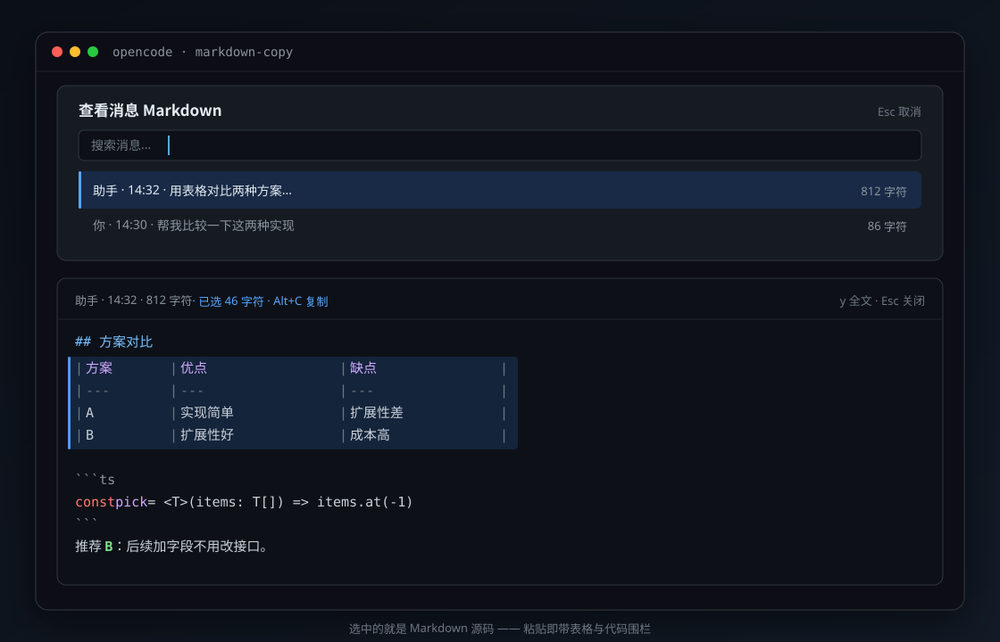

# markdown-copy

[](https://github.com/wuzhupc/markdown-copy/actions/workflows/ci.yml)
[](LICENSE)
[](https://opencode.ai)

**在 OpenCode TUI 里，把任意一条会话消息当 Markdown 源码打开，选中哪段就复制哪段。**

内置 `/copy` 只能整条复制最后一条助手回复，而且拿到的是渲染后的文本。`markdown-copy` 把消息的**原始 Markdown** 放在一个只读面板里：你拖选表格中的两行、一段代码围栏、半个列表，按 `Alt+C` 就原样进剪贴板 —— 管道符、围栏、`##` 一个都不会丢。



[English](README.en.md) · [更新日志](CHANGELOG.md) · [参与贡献](CONTRIBUTING.md)

---

## 与内置 `/copy` 的区别

| | 内置 `/copy` | markdown-copy |
| --- | --- | --- |
| 可选消息 | 最后一条助手回复 | 任意用户 / 助手 / 压缩摘要消息 |
| 复制粒度 | 整条 | 任意选区，也可以 `y` 复制整条 |
| 复制内容 | 渲染后的文本 | 原始 Markdown 源码 |
| 找历史消息 | 需要往上翻、手动选中 | 带关键字过滤的选择器，默认定位最后一条助手回复 |

## 特性

- **任意历史消息**：选择器按时间列出用户消息、助手正文与已完成的压缩摘要，支持搜索过滤。
- **选区即源码**：面板里显示的就是消息 `text` 原文，选中的片段直接是合法 Markdown。
- **不依赖终端选区生命周期**：拖选结束时就缓存选区，即使按键时宿主清掉了选区，`Alt+C` 也能拿到内容。
- **剪贴板双通道**：Windows 走系统 `Set-Clipboard`（UTF-8 stdin，结果确定）；macOS / Linux / SSH 优先 OSC 52，超长或终端不支持时回退 `pbcopy` / `wl-copy` / `xclip` / `xsel`。
- **零 npm 依赖**：纯 TypeScript / TSX / ESM，直接由 OpenCode 加载。
- **入口齐全**：`Alt+M`、斜杠命令 `/mdsrc`（别名 `/copymd`、`/md-copy`）、命令面板 `View message as Markdown`。

## 环境要求

- OpenCode **v2.4.1** 及以上（插件 API 在该版本核对通过）
- 仅 TUI 生效（`opencode` 交互界面），不涉及 Web / Desktop
- 无第三方依赖；`bun` 只在安装前的打包校验和开发时用到

## 安装

插件目录：`~/.config/opencode/plugins/markdown-copy`（Windows 为 `%USERPROFILE%\.config\opencode\plugins\markdown-copy`）。

### Windows

```powershell
git clone https://github.com/wuzhupc/markdown-copy.git
cd markdown-copy
pwsh -File .\deploy.ps1
```

### macOS / Linux

```bash
git clone https://github.com/wuzhupc/markdown-copy.git
cd markdown-copy
chmod +x ./install.sh
./install.sh
```

### 自定义目录

```powershell
pwsh -File .\deploy.ps1 -Destination D:\tools\opencode-plugins\markdown-copy
```

```bash
./install.sh /path/to/plugins/markdown-copy
```

### 手动安装

把 `tui.ts`、`panel.tsx`、`messages.js`、`clipboard.js`、`package.json` 复制到 `~/.config/opencode/plugins/markdown-copy/` 即可。

### 验证

```bash
opencode plugin list   # 应能看到 local .../plugins/markdown-copy
```

运行中的 TUI 会监听配置目录并自动重载插件；没生效就重启一次 TUI。

## 使用

1. 在会话中按 `Alt+M`，或输入 `/mdsrc`（`/copymd`、`/md-copy`），或 `Ctrl+P` → `View message as Markdown`。
2. 在选择器里挑一条消息（可输入关键字过滤，默认选中最后一条助手回复）。
3. 源码面板打开后：
   - 鼠标拖选任意片段 → `Alt+C` 复制；
   - `y` 复制整条消息；
   - `Esc` 关闭，方向键 / 滚轮滚动。
4. 顶部出现 `已选 N 字符` 表示 TUI 已捕获选区；复制成功会弹 toast，并注明走了哪个通道。

### 快捷键

| 按键 | 作用 |
| --- | --- |
| `Alt+M` | 打开消息选择器 |
| `/mdsrc`、`/copymd`、`/md-copy` | 同上（斜杠命令） |
| `Alt+C` | 复制当前选区 |
| `y` | 复制整条消息 |
| `Esc` | 关闭源码面板 |

## 工作原理

```
Alt+M / /mdsrc
      │
      ▼
context.data.session.message.list()  →  messages.js 提取 text 原文
      │
      ▼
context.ui.dialog.select()  →  选一条消息
      │
      ▼
session.panel 槽位  →  panel.tsx 用 <code filetype="markdown"> 渲染源码
      │
      ▼
拖选 → context.renderer.getSelection() → clipboard.js → OSC 52 / 系统命令
```

面板是只读的，不会改动会话内容；关闭面板不影响消息本身。

## 故障排查

| 现象 | 处理 |
| --- | --- |
| `Alt+M` 没反应 | 终端可能吞掉了 Alt 组合键，改用 `/mdsrc` 或命令面板 |
| 顶部没有变成 `已选 N 字符` | 你可能用了 `Shift+拖动`（终端原生选区），此时请用终端自己的复制键 |
| 复制成功但粘贴是旧内容 | tmux 用户执行 `set-clipboard on`；或终端不支持 OSC 52，检查 toast 里的通道 |
| 提示「面板不可用」 | OpenCode 版本过低（< 2.4.1）；插件会退化为复制整条消息 |
| 提示「没有可用的剪贴板命令」 | 安装 `wl-clipboard` / `xclip` / `xsel`，或改用支持 OSC 52 的终端 |
| 长消息打开面板略慢 | 语法高亮需要解析，纯文本内容不受影响 |
| 中文粘贴成乱码 | Windows 走 `powershell.exe` + UTF-8 stdin；确认系统 PowerShell 未被策略拦截 |

## 开发

```powershell
git clone https://github.com/wuzhupc/markdown-copy.git
cd markdown-copy

# 单元测试（纯 Node，不碰剪贴板）
node .\tests\messages.test.mjs

# 剪贴板测试（会覆盖当前剪贴板，仅 Windows 做真实回读）
node .\tests\clipboard.test.mjs

# 打包校验
bun build .\tui.ts --target bun --jsx-runtime automatic --jsx-import-source "@opentui/solid" `
  --external "@opencode/plugin/tui" --external "@opentui/core" --external "@opentui/solid" --external "solid-js" `
  --outfile .\dist\check.js

# 部署到本机插件目录（默认先做打包校验）
pwsh -File .\deploy.ps1
```

- 只改源码目录，**不要改部署目录**（下次部署会被覆盖）。
- 改版本号请同步 `package.json` 的 `version` 与 `CHANGELOG.md`。

### 目录结构

| 路径 | 作用 |
| --- | --- |
| `tui.ts` | 插件入口：命令、快捷键、斜杠命令、消息选择器 |
| `panel.tsx` | `session.panel` 槽位：只读源码视图、选区复制、复制全文、关闭 |
| `messages.js` | 从会话消息提取可查看文本、生成选择器条目 |
| `clipboard.js` | 写剪贴板：Windows 系统命令 / OSC 52 / `pbcopy`、`wl-copy`、`xclip`、`xsel` |
| `tests/` | 纯 Node 单元测试 |
| `deploy.ps1` | Windows 打包校验 + 部署 |
| `install.sh` | macOS / Linux 部署 |
| `docs/preview.svg` | README 示意图 |

## 已知限制

- 源码面板只读，不可编辑。
- 复制依赖 TUI 的文本选区；用终端原生选区（`Shift+拖动`）时插件读不到内容。
- 非 Windows 平台超过 100 KB 的内容不走 OSC 52（避免终端截断），改用系统剪贴板命令。
- 依赖 OpenCode 的 TUI 插件 API；上游大版本变动时可能需要适配。

## 升级与卸载

- `opencode upgrade` 不会删除插件目录，插件也不需要重装。
- 卸载：删除 `~/.config/opencode/plugins/markdown-copy`，或改名为 `markdown-copy.disabled`。

## License

[MIT](LICENSE) © 2026 wuzhupc
